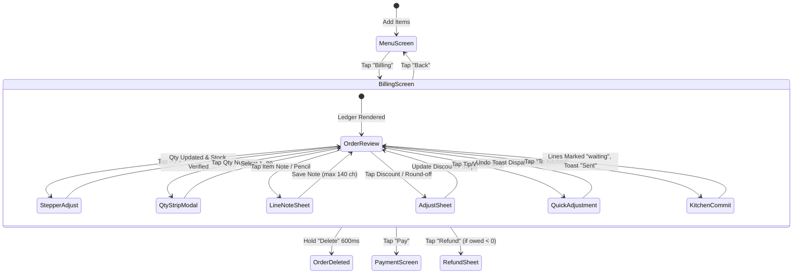

# Architectural Specification: Mobile Billing Screen (Order Ledger)
**Stall App Mobile — High-Throughput Fair Stall POS Architecture**  
**Author:** Billing Screen Architect  
**Target Viewports:** Mobile Portrait (360×780, 390×844, 428×926) & Tablet / Dual-Pane (768px+)  
**Standard Compliance:** Apple Human Interface Guidelines (HIG), YouTube/Spotify Mobile Queue Paradigm, WCAG AAA  
**Location:** `src/ui/counter/billing/` (`BillingScreen.tsx`, `Billing.module.css`, `OrderLedgerCard.tsx`, `TotalsCard.tsx`, `BillingActionBar.tsx`)

---

## 1. Executive Summary & Mobile UX Paradigm Shift

### 1.1 The Operational Environment: Fast-Paced Counter Checkout
The Counter attendant in a festival food stall manages continuous customer transactions during peak rushes (100+ orders per hour). In this environment:
1. **One-Thumb Operation**: Attendants hold a mobile device in one hand while speaking with customers, handing over receipts, or checking kitchen status. Every critical control must reside within the natural bottom arc ("thumb zone").
2. **Cognitive Clarity Under Pressure**: Customers frequently modify orders at the billing step ("make that two coffees, add extra sugar, actually drop the pastry"). The attendant cannot squint at dense tables or hunt for tiny touch targets.
3. **Auditability**: Prices, line totals, discounts, round-offs, tips, and waivers must be instantly verifiable before routing to cash or UPI payment.

### 1.2 The Failure of Legacy 5-Column HTML Tables on Mobile
The current implementation renders a classical desktop HTML `<table>` (`.sheet`) containing 5 columns:
```html
<table className={s.sheet}>
  <thead><tr><th>#</th><th>Item</th><th>Qty</th><th>Rate</th><th>Amount</th></tr></thead>
  ...
</table>
```
This desktop paradigm catastrophically degrades on mobile viewports (360px–390px):
- **Viewport Blowout**: Fixed column widths (`#` 1.25rem + `Item` flexible + `Qty` 8.25rem + `Rate` 3.5rem + `Amount` 4.75rem = 17.75rem / 284px) plus 1rem padding per cell force horizontal scroll (`overflow-x: auto`) on 360px screens (where total width minus stage margins is only 328px).
- **Cramped Touch Targets**: Stepper buttons (`.qb`) are squeezed into narrow table cells, risking mis-taps between `−`, `+`, and the quantity display.
- **Hidden Context**: Item notes, category labels, and rates are clipped or forced onto awkward pseudo-grid rows via brittle `@container (max-width: 30rem)` hacks.
- **Accessibility & Contrast Deficits**: Table cells mix numeric alignment and action buttons, creating poor screen-reader navigation and broken semantic hierarchy.

### 1.3 The Modern Solution: Fluid Order Card List (YouTube / Spotify Queue Mental Model)
Instead of forcing a desktop spreadsheet onto a phone, the mobile redesign adopts the proven mental model of **YouTube Queue / Spotify Playlist Ledger**:
- **Vertical Stream of Tactile Item Cards**: Each line is an independent, beautifully formatted squircle card (`OrderLedgerCard`).
- **Primary Information Anchor (Top/Left)**: Item Name, Category Tag, and Note Snippet display with high typographic clarity.
- **Secondary Transaction Anchor (Right)**: Unit rate and line total prominently right-aligned in bold tabular numbers.
- **Tactile Manipulation Anchor (Bottom/Right)**: Dedicated 48px touch stepper (`− / qty / +`) allowing one-thumb adjustments without shifting grip.
- **Floating Sheet Integration**: Tapping the quantity opens a rapid selection strip or numeric pad; tapping the note snippet opens the full line note editor.

---

## 2. Visual Architecture & Component Breakdown ("HOW IT SHOWS")

### 2.1 Order Meta Header (`MetaRow`)
Docked at the top of the scrollable stage, providing ambient context for the active transaction:
- **Giant Token Badge**: Displays formatted order token (e.g. `Token #042`), linking the bill directly to kitchen and queue callouts.
- **Priority Rush Toggle Switch**:
  - High-visibility pill switch (`o.priority`).
  - When active: Glowing amber/fire tint (`color-mix(in srgb, var(--dl-stall-st-priority) 14%, transparent)`) with animated priority icon.
  - Toggling immediately notifies the kitchen and applies `pauseMoves` across stations.
- **Serving Attendant Chip**: Displays `Serving: Aarav`. Tapping opens `ServingSheet` to reassign the order attendant.

```
┌──────────────────────────────────────────────────────────┐
│  Token #042       [⚡ Priority: ON]      [Serving: Aarav]│
└──────────────────────────────────────────────────────────┘
```

---

### 2.2 Tactile Order Card List (Ledger List)
Replacing the HTML table with a fluid, container-queried card list (`.ledgerList`).

```
┌──────────────────────────────────────────────────────────┐
│ ┌──────────────────────────────────────────────────────┐ │
│ │  Butter Masala Dosa                    ₹120.00       │ │
│ │  [Grill]  ✎ Extra butter, crisp                      │ │
│ │  ─────────────────────────────────────────────────── │ │
│ │  Rate: ₹60.00         [ − ]     2     [ + ]  ₹120.00 │ │
│ └──────────────────────────────────────────────────────┘ │
│ ┌──────────────────────────────────────────────────────┐ │
│ │  Masala Chai                            ₹40.00       │ │
│ │  [Beverages]  ✎ Less sugar                           │ │
│ │  ─────────────────────────────────────────────────── │ │
│ │  Rate: ₹20.00         [ − ]     2     [ + ]   ₹40.00 │ │
│ └──────────────────────────────────────────────────────┘ │
│  + [ Add Order Note: "Pack in separate bags" ]          │
└──────────────────────────────────────────────────────────┘
```

#### Detailed Anatomy of `OrderLedgerCard`:
1. **Header Row**:
   - **Item Name**: Bold, high-contrast display text (`var(--dl-color-text-display)`, `font-size: 1rem`, `font-weight: 600`).
   - **Line Total**: Hero tabular numeral (`font-size: 1.125rem`, `font-weight: 700`), right-aligned.
2. **Metadata & Note Sub-Row**:
   - **Category Tag**: Subtle rounded pill (`font-size: 0.6875rem`, muted background).
   - **Note Snippet**: Italicized note text prefixed with pencil icon (`<Icon name="note" />`). If note contains allergy keywords (`nut`, `gluten`, `vegan`, `dairy`), highlights in amber warning tint.
   - **Direct Edit Trigger**: Tapping the note snippet or pencil button directly opens `LineNote` sheet.
3. **Tactile Control & Stepper Sub-Row**:
   - **Unit Rate**: Muted tabular display (`Rate: ₹60.00`).
   - **48px Tactile Stepper**:
     - Decrement button (`[ − ]`): `min-width: 3rem`, `min-height: 3rem` (48px × 48px). If `qty === 1`, icon shifts to trash/delete tint indicating line removal.
     - Quantity indicator (`[ 2 ]`): High-contrast tabular box (`min-width: 2.75rem`). Tapping opens `QtyStrip` or Numpad sheet.
     - Increment button (`[ + ]`): `min-width: 3rem`, `min-height: 3rem` (48px × 48px). Checks remaining stock via `available(itemId)`.
   - **Touch Feedback**: Active state scales down button (`transform: scale(0.96)`) with instant selection haptic buzz.

---

### 2.3 Inline Quick Adjustment Chips (Tip & Waive)
Festival transactions frequently involve small gratuities or quick rounded discounts (e.g. customer leaves change or stall waives small balance).
- Rather than burying adjustments behind multiple dialog layers, the Billing Screen renders an **Inline Adjustment Bar**:
  ```
  Tip:   [ +₹10 ]  [ +₹20 ]  [ +Other ]
  Waive: [ −₹10 ]  [ −₹20 ]  [ −Other ]
  ```
- **Instant Reactive Total**: Tapping `+₹10` immediately updates the Net Total and syncs `ui.payDrafts[orderId]`.
- **Undo Toast Capability**: Triggers a 5000ms floating toast (`+ Tip ₹10 · Undo`), allowing accidental adjustments to be instantly reversed without modal friction.

---

### 2.4 Crystallized Summary Totals Card (`TotalsCard`)
A dedicated squircle summary container with crystal-clear financial hierarchy:

```
┌──────────────────────────────────────────────────────────┐
│  SUMMARY                                                 │
│  Subtotal                                        ₹160.00 │
│  Discount (10% - VIP promo)                     −₹16.00 │
│  Round-off                                       +₹0.00 │
│  ─────────────────────────────────────────────────────── │
│  NET TOTAL DUE                                   ₹144.00 │
│  ─────────────────────────────────────────────────────── │
│  [ Edit Discount & Round-Off ]   [ Tip or Waive Details ]│
└──────────────────────────────────────────────────────────┘
```

#### Financial Hierarchy Rules:
1. **Subtotal**: Pure sum of all line items (`bill.subtotal(o)`).
2. **Discount**:
   - Shown only when active (`d.value > 0`).
   - Displays reduction in warning/accent color (`--dl-stall-warn-text`).
   - Subtitle displays manager authorization: `Allowed by Steve`.
3. **Round-Off**:
   - Shown when non-zero (`ro !== 0`).
   - Explicitly validated against `bill.preRound(o)`. If the order items change, stale round-off is automatically invalidated.
4. **Net Total Due (Hero Display)**:
   - Oversized tabular numerals (`font-size: 1.75rem`, `font-weight: 800`).
   - Enhanced with subtle ambient glow (`text-shadow: var(--dl-stall-glow)`).
   - If previous payments exist: Shows `Paid so far: ₹X` and calculates outstanding `Due: ₹Y`.
   - If overpaid (e.g. item returned after payment): Displays vibrant emerald/amber badge `Refund Due: ₹Z`.

---

### 2.5 Sticky Thumb-Zone Action Bar (`BillingActionBar`)
Docked firmly to the bottom viewport with safe-area inset accommodation (`calc(0.75rem + env(safe-area-inset-bottom))`).

```
┌──────────────────────────────────────────────────────────┐
│ [ Back ]   [ 🗑 Hold to Delete ]   [ To Kitchen ] [ Pay ] │
│               Pay sends it to the kitchen too            │
└──────────────────────────────────────────────────────────┘
```

#### Button Specifications:
| Button | Hit Target | Visual Styling | Function & Safety Lock |
|---|---|---|---|
| **Back** | 4rem min-width, 3.5rem height | Frosted neutral background | Returns to Menu screen (`c.setPage('menu')`), retaining all draft lines |
| **Delete** | 4rem min-width, 3.5rem height | Crimson danger tint (`--dl-stall-del-bg`) | **600ms Hold-to-Delete** with linear progress bar fill (`scaleX`). Prevents accidental order annihilation. Guarded against paid or kitchen-cooking orders |
| **To Kitchen** | Flex 1, 3.5rem height | Forest green go tint (`--dl-stall-go`) | Commits all `draft` lines to the kitchen (`waiting`). Disabled if zero draft lines remain |
| **Pay CTA** | Flex 1.4, 3.5rem height | High-contrast brand CTA (`--dl-stall-cta`) | Routes directly to `PaymentScreen`. If refund is owed, shifts label to `Refund ₹X` and opens Refund Sheet |

---

## 3. HOW IT WORKS: Tactile Mechanics & State Machine



### 3.1 Stepper Interaction & Anti-Flutter Protection
1. **Decrement (`−`)**:
   - If `line.qty > 1`: Dispatches `c.setQty(lineId, line.qty - 1)`.
   - If `line.qty === 1`: Tapping decrement safely removes the line item (`c.setQty(lineId, 0)`). Haptic buzz emits warning pulse.
   - **Kitchen Lockout Guard**: If `line.status !== 'draft'` (e.g. kitchen cook is already preparing the dish), decrement is rejected with a calm toast: `"Already being made; change it from the kitchen"`.
2. **Increment (`+`)**:
   - Queries `available(line.itemId)`.
   - If stock is exhausted, tap is rejected with toast: `"[Item] is sold out"`.
   - If stock is constrained, permits increment up to available limit and notifies: `"Only X more left"`.
   - Maximum quantity capped at `CONFIG.limits.qtyMax` (99).
3. **Debounce & Gesture Isolation**:
   - Stepper buttons declare `touch-action: manipulation` to prevent double-tap browser zoom delays.
   - Pointer move greater than `CONFIG.gesture.moveCancelPx` (10px) cancels button depression, prioritizing ledger list scroll.

### 3.2 Quick Quantity Strip & Numpad Sheet
- Tapping the numeric quantity badge opens a floating segment strip (`1, 2, 3, 4, 5`) centered on the active item.
- For high-volume multi-pack orders (e.g. 10 samosas, 24 chais), a `"..."` option opens `NumpadSheet`, allowing instantaneous direct entry of two-digit numbers.

### 3.3 Hold-to-Delete Progressive Mechanics
Accidental deletion of a 6-item order during a rush creates chaos. The Delete action utilizes strict tactile gating:
1. **Hold Duration**: Strictly set to `HOLD.durationMs` (600ms).
2. **Progressive Visual Fill**:
   - The button contains an absolute backdrop layer (`.holdFill`).
   - On `pointerdown`, `.holdFill` scales from `scaleX(0)` to `scaleX(1)` with linear timing over 600ms.
3. **Tactile Haptic Feedback**:
   - At start of press: Short `selection` buzz (8ms).
   - At 600ms completion: Distinct `confirm` double-pulse (`[12, 40, 18]`).
4. **Early Release / Gesture Cancellation**:
   - Releasing before 600ms cancels the timer, instantly snaps `.holdFill` back to `scaleX(0)`, and displays a gentle toast: `"Hold to delete this order"`.
   - Moving the pointer outside the button bounds (`onPointerLeave` / `onPointerCancel`) aborts the deletion without triggering hint toasts.
5. **Business Safety Checks**:
   - Deletion is refused if payments are held (`held(o) > 0`): `"Refund the payment before deleting"`.
   - Deletion is refused if kitchen has started preparing: `"The kitchen has started this order"`.

### 3.4 Sent vs Draft Kitchen Synchronization
- In Stall App POS, lines in an active order can have differing statuses:
  - `draft`: Added at counter, not yet visible to cooks.
  - `waiting`: Sent to kitchen, queued for cooking.
  - `preparing`: Cook is actively working on it.
  - `ready`: Cook finished; waiting for pickup.
- **The "To Kitchen" Trigger**:
  - Checks `lines.some(l => l.status === 'draft')`.
  - Dispatches `order.send`. Draft lines transition to `waiting`.
  - Attendant receives immediate feedback: `"Sent to the kitchen"` toast; button state transitions to disabled `"In kitchen"`.
- **The "Pay" Dual Trigger**:
  - Pushing "Pay" routes to the payment terminal, and automatically sends any unsent draft lines to the kitchen, guaranteeing cooks begin prep while payment is being processed.

---

## 4. WHAT IT TAKES & GIVES BACK: Inter-Screen Contract

### 4.1 Inputs Required from Menu Screen
The Billing Screen mounts when the attendant taps "Billing" on `MenuScreen` or selects an open order.
- **Required Context via Store**:
  - `ui.orderId`: Non-null active Order UUID.
  - `o.token`: Sequential token number for queue display.
  - `o.lines[]`: Array of line items:
    * `lineId`: Unique line identifier.
    * `itemId`: Catalog item reference.
    * `name`: Item display name.
    * `category`: Menu section tag (e.g. `Beverages`, `Grill`, `Momos`).
    * `price`: Unit price in Paise (`₹1 = 100 paise`).
    * `qty`: Current item quantity (`1..99`).
    * `note`: Line modification string (max 140 chars).
    * `status`: Line lifecycle state (`'draft' | 'waiting' | 'preparing' | 'ready' | 'handed'`).
    * `stationId`: Kitchen routing target.
  - `o.priority`: Boolean rush flag.
  - `o.servedBy`: Attendant name string.

### 4.2 Outputs Provided to Payment Screen
When navigating from Billing to Payment (`c.setPage('payment')`), Billing establishes the immutable financial contract:
- **Financial Ledger Payload**:
  - `subtotal`: `bill.subtotal(o)` (paise).
  - `discount`: `bill.discountAmount(sub, o.discount)` (paise).
  - `roundOff`: `bill.roundOffAmount(o)` (paise).
  - `netTotal`: Total pre-payment amount due (`bill.total(o)`).
  - `paid`: Previously collected funds from payments log (`bill.paid(o)`).
  - `due`: Net outstanding amount to collect (`bill.due(o)`).
  - `payDrafts[orderId]`:
    * `tip`: Tip amount pre-configured via billing chips.
    * `waived`: Waived amount pre-configured via billing chips.
    * `waivedBy`: Attendant authorizing waiver.
    * `waivedNote`: Justification note for audit log.

### 4.3 Outputs Provided to Kitchen Screen
All modifications on the Billing screen immediately synchronize with kitchen KDS displays:
1. **`order.send`**:
   - Converts all local draft lines into kitchen-visible orders.
   - Appears immediately on KDS with fresh arrival animation.
2. **`order.priority`**:
   - Toggling the Priority switch immediately applies `pauseMoves` across kitchen stations, pausing lower-priority prep tickets and hoisting the priority ticket to the front.
3. **`line.qty` & `line.note`**:
   - If a line is adjusted while still in `draft`, changes update seamlessly without alarming the kitchen.
   - If an order is deleted, cancels ticket across all kitchen stations.

---

## 5. RESPONSIVE VIEWPORT ARCHITECTURES

### 5.1 Mobile Portrait — Compact (360×780, e.g. iPhone SE / Budget Android)
```
┌────────────────────────────────────────┐
│ Token #042     [⚡ Prio]   [Serving]   │  <-- Meta Row (44px)
├────────────────────────────────────────┤
│ ┌────────────────────────────────────┐ │
│ │ Butter Masala Dosa         ₹120.00 │ │  <-- Compact Card (72px)
│ │ [Grill]                            │ │
│ │ Rate: ₹60   [−]  2  [+]    ₹120.00 │ │
│ └────────────────────────────────────┘ │
│ ┌────────────────────────────────────┐ │
│ │ Masala Chai                 ₹40.00 │ │
│ │ Rate: ₹20   [−]  2  [+]     ₹40.00 │ │
│ └────────────────────────────────────┘ │
│                                        │
│ ┌────────────────────────────────────┐ │
│ │ Subtotal: ₹160   Discount: −₹16    │ │  <-- Compact Totals Card
│ │ NET TOTAL DUE: ₹144.00             │ │
│ └────────────────────────────────────┘ │
├────────────────────────────────────────┤
│ [Back] [🗑 Hold] [To Kitchen] [ Pay ]  │  <-- Sticky Action Bar (56px)
└────────────────────────────────────────┘
```
- **Layout Adjustments**:
  - Padding reduced to `0.5rem 0.75rem`.
  - Item name and total row condensed; note snippet truncated to single line with ellipsis.
  - Action row stays on a single line with compact button text (`[Back] [Delete] [Kitchen] [Pay]`).

### 5.2 Mobile Portrait — Standard (390×844 / 428×926, iPhone 13/14/15/Pro Max)
- Generous touch spacing (`0.75rem 1rem`).
- Cards expand comfortably; full two-line note snippets with direct tap editing.
- Stepper targets maintain generous 48px × 48px hit areas with 8px gutters.
- Inline Tip and Waive chips fully visible without horizontal scroll.

### 5.3 Tablet & Desktop Dual-Pane (768px+, `@container counter (min-width: 48rem)`)
Under `CONFIG.layout.twoPaneMinRem` (48rem / 768px), `CounterShell` renders dual side-by-side panes:
```
┌────────────────────────────────┬────────────────────────────────┐
│ MENU (Left 50% Pane)           │ BILLING (Right 50% Pane)       │
│ [All] [Beverages] [Grill]      │ Token #042        [⚡ Priority] │
│ ┌──────────────┐┌────────────┐ │ ┌────────────────────────────┐ │
│ │ Samosa       ││ Chai       │ │ │ 2× Dosa            ₹120.00 │ │
│ │ ₹30.00       ││ ₹20.00     │ │ │ 2× Chai             ₹40.00 │ │
│ └──────────────┘└────────────┘ │ └────────────────────────────┘ │
│                                │ Subtotal: ₹160  Total: ₹144.00 │
│                                │ [Back] [Delete] [Kitchen][Pay] │
└────────────────────────────────┴────────────────────────────────┘
```
- **Split Synergy**: Left pane displays `MenuScreen` grid; right pane displays `BillingScreen` ledger in real-time.
- Attendants can tap items on the menu grid on the left and see the ledger card list immediately update on the right without page navigation transitions!

---

## 6. Implementation & Refactoring Roadmap

### 6.1 Component Modularization Hierarchy
To strictly satisfy ESLint rules (`max-lines-per-function: 40`, `max-depth: 3`), `BillingScreen.tsx` will be refactored into modular, dedicated units:

```
src/ui/counter/billing/
├── BillingScreen.tsx        // Top-level coordinator & container layout (< 40 lines)
├── OrderMetaRow.tsx         // Token display, priority switch, attendant name (< 35 lines)
├── OrderLedgerList.tsx      // Virtualized/scrollable list of ledger cards (< 35 lines)
├── OrderLedgerCard.tsx      // Single item card with name, tags, and notes (< 40 lines)
├── OrderStepper.tsx         // 48px touch stepper (− / qty / +) & stock check (< 35 lines)
├── QtyStrip.tsx             // Quick 1..5 quantity selector strip (< 30 lines)
├── TotalsCard.tsx           // Subtotal, discount, round-off, net total (< 40 lines)
├── InlineAdjustChips.tsx    // Fast Tip & Waive chips with undo toast (< 35 lines)
├── BillingActionBar.tsx     // Sticky Back, Hold-Delete, To Kitchen, Pay bar (< 40 lines)
└── Billing.module.css       // Pure CSS Modules + Driftline tokens (zero px, color-mix)
```

### 6.2 Key Architectural Subscriptions
- Subscribes to `folded.orders[orderId]` via `useApp`.
- Subscribes to `ui.payDrafts[orderId]` for draft tip/waiver amounts.
- Dispatches via `counterActions`: `setQty`, `setLineNote`, `setOrderNote`, `setDiscount`, `setRoundOff`, `sendToKitchen`, `deleteOrder`, `setPage`, `toast`.

---

## 7. Verification Matrix & Quality Standards

| Requirement | Metric / Standard | Verification Test |
|---|---|---|
| **Zero Viewport Blowout** | No horizontal table scroll on 360px portrait | Container query test on 360px viewport |
| **Touch Reliability** | Minimum 48px hit targets for steppers | Computed bounding box of `.qb` ≥ 48px |
| **Accidental Delete Guard**| 600ms hold with progressive visual fill | `HOLD.durationMs` test; release at 400ms cancels |
| **Kitchen Sync Integrity** | Draft lines commit to waiting on send | State verification: `l.status === 'waiting'` |
| **Financial Accuracy** | Net total reflects sub - disc + ro + tip - waive | Calculation unit tests via `bill.ts` |
| **ESLint Compliance** | `max-lines-per-function <= 40`, `max-depth <= 3` | `npm run lint` with 0 warnings |
| **Token Compliance** | Zero raw `px`, zero `rgba()`, 100% Driftline | Token scanning script verification |
| **Motion Accessibility** | Spring physics scale down gracefully under reduced motion | `prefers-reduced-motion` media query verification |
